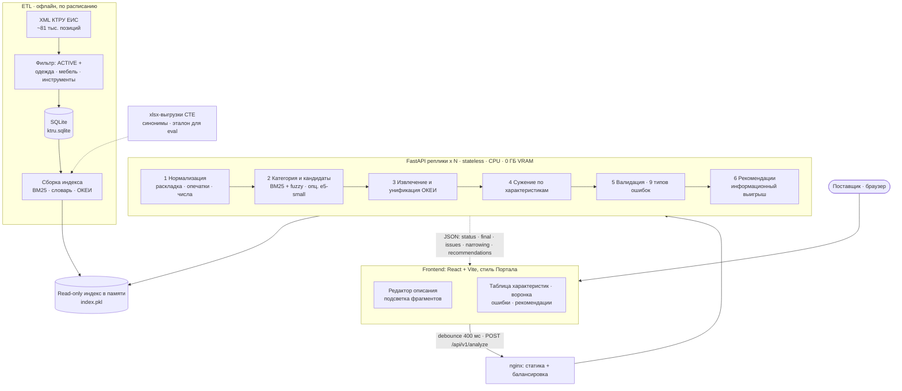

# Архитектура

Сервис автозаполнения ключевых характеристик СТЕ по КТРУ (Tender Hack, Казань). Схема процесса в BPMN 2.0: [bpmn/process.bpmn](bpmn/process.bpmn) (рендер: [png](bpmn/process.png), [svg](bpmn/process.svg)).

## 1. Схема компонентов

| Компонент | Роль | Технологии |
|---|---|---|
| Frontend | ввод описания, подсветка фрагментов, редактируемая таблица, воронка сужения, ошибки и рекомендации | React 18, Vite, TypeScript |
| nginx | раздача статики, балансировка по репликам, gzip | nginx |
| Backend (реплика) | stateless-анализ запроса за миллисекунды на CPU | FastAPI, uvicorn, pydantic v2 |
| Ядро анализа | нормализация, поиск, извлечение, сужение, валидация, рекомендации | rapidfuzz, rank-bm25, pymorphy3, numpy |
| Индекс | read-only артефакт, грузится в память при старте | pickle (`data/build/index.pkl`) |
| ETL | XML КТРУ из ЕИС -> фильтр -> SQLite -> индекс | lxml, sqlite3, openpyxl |
| Опц. эмбеддер | семантический поиск при низкой уверенности лексического | `intfloat/multilingual-e5-small` (118M, CPU/ONNX) |

## 2. Поток данных

1. **Офлайн (ETL).** Актуальная выгрузка КТРУ (XML ЕИС, ~81 тыс. позиций) -> фильтр `ACTIVE` и категорий (одежда, мебель, инструменты; ~15-20 тыс. позиций) -> SQLite (позиции, характеристики, допустимые значения и диапазоны, ОКЕИ) -> индекс: BM25 по наименованиям и характеристикам, словарь для исправления опечаток, таблица единиц и коэффициентов приведения. xlsx-выгрузки СТЕ добавляют синонимы и служат эталоном для оценки (при расхождении приоритет у КТРУ).
2. **Онлайн.** UI после паузы ввода 400 мс отправляет `POST /api/v1/analyze` (текст + правки таблицы + отклонённые замечания). Реплика:
   1. нормализует текст (раскладка, транслит, опечатки по словарю КТРУ, числа и единицы);
   2. определяет категорию и кандидатов (BM25 + fuzzy, опционально e5-small);
   3. извлекает пары «характеристика - значение - единица» и приводит единицы к ОКЕИ позиции;
   4. пошагово сужает кандидатов по характеристикам, фиксируя шаги воронки (before/after, исключённые коды);
   5. валидирует: 9 типов ошибок (`typo`, `layout`, `unit_mismatch`, `value_not_allowed`, `out_of_range`, `missing_required`, `contradiction`, `unknown_characteristic`, `category_mismatch`), каждая с обоснованием и предложением замены;
   6. при неоднозначности строит рекомендации по информационному выигрышу (характеристика, лучше всего делящая оставшихся кандидатов).
3. Ответ: `status` (resolved / ambiguous / not_found / empty), `final`, `candidates`, характеристики, `issues`, `narrowing`, `recommendations`; у каждого элемента `reason` и `confidence`. Контракт: [specs/001-ktru-autofill/contracts/api.md](../specs/001-ktru-autofill/contracts/api.md).

## 3. Обоснование технологий и алгоритмов

### Почему без LLM на горячем пути
- **Скорость.** Правила + BM25 + fuzzy дают десятки-сотни мс на CPU; LLM 7B+ - секунды и GPU, что несовместимо с «живым» режимом (цель: результат не позже 2 с после остановки ввода).
- **Детерминизм.** Одинаковый ввод даёт одинаковый ответ, поведение тестируется (eval одной командой). LLM может «придумать» код или значение, которых нет в КТРУ.
- **Объяснимость.** Каждое решение привязано к правилу справочника (допустимый диапазон, единица ОКЕИ, расстояние до слова словаря) - это прямо требуется критерием «распознавание ошибок».
- **Ограничения хакатона.** Только открытые модели <= 40 ГБ VRAM, приоритет лёгким, запрет проприетарных API. Решение использует 0 ГБ VRAM; опциональный эмбеддер - 118M параметров на CPU.
- **Стоимость и масштаб.** CPU-реплики дёшевы и масштабируются линейно, нет очереди к GPU.

### Почему BM25 + fuzzy + правила
- Наименования КТРУ короткие, терминологичные, с числовыми атрибутами: лексический поиск (BM25 по леммам, pymorphy3) точен и объясним.
- Fuzzy (rapidfuzz, расстояние Левенштейна по словарю КТРУ) закрывает опечатки и смешанную раскладку; словарь ограничен предметной областью, ложных исправлений мало.
- Числа, единицы и диапазоны - детерминированная задача: регулярные выражения + таблица ОКЕИ точнее и быстрее любой модели.
- Сужение - фильтрация множества кандидатов по допустимым значениям и интервалам; рекомендации - выбор признака с максимальным информационным выигрышем (энтропия разбиения кандидатов).

### Где опционально e5-small
`intfloat/multilingual-e5-small` (118M параметров, CPU/ONNX, около 0.5 ГБ RAM) - запасной канал, когда лексический поиск даёт низкую уверенность (описание «своими словами», синонимы, которых нет в КТРУ). Результаты объединяются с BM25 (reciprocal rank fusion). Включается флагом; без него сервис полностью функционален.

## 4. Масштабирование

- **Stateless API.** Состояние сессии не хранится; правки таблицы и отклонённые замечания приходят в запросе. Любая реплика обслуживает любой запрос.
- **Read-only индекс.** Грузится в память при старте (RAM реплики <= 2 ГБ; измерено ~190 МБ RSS после загрузки индекса), без блокировок и записи; обновление - новый артефакт и rolling restart.
- **Горизонтальное масштабирование.** N реплик uvicorn за nginx (`docker compose up --scale api=N`), далее Kubernetes HPA по CPU.
- **Производительность (замер).** Цель >= 50 RPS на реплику (p95 <= 300 мс без эмбеддера). Факт: один процесс uvicorn, 1000 запросов `POST /api/v1/analyze` (14 примеров из `/examples`) в 8 потоков: ~570 RPS, p50 14 мс, p95 20 мс, p99 31 мс; RSS ~183 МБ после старта, ~193 МБ после нагрузки. Одиночный запрос: p95 6.4 мс (eval, 749 кейсов). Клиент и сервер на одной машине (macOS), эмбеддер выключен. 4 реплики ~ 4x; рост нагрузки в 5 раз покрывается репликами (SC-007).
- **Нагрузка от UI.** Debounce 400 мс и отмена устаревших запросов (AbortController) снижают число запросов на пользователя; ответы идемпотентны и кэшируемы по хэшу тела.

## 5. Безопасность и ограничения

- Нет внешних вызовов во время работы (офлайн), нет ключей и платных API; персональные данные не хранятся.
- Валидация входа: длина текста <= 2000, Pydantic-схемы, лимит размера тела и rate limiting на nginx.
- Текст пользователя не логируется в открытом виде (хэш и метрики).
- CORS ограничен доменом UI; контейнеры без root.
- Ограничения v1: три категории; одна позиция на запрос; русский язык; пакетная загрузка вне v1; качество зависит от полноты КТРУ и словаря синонимов.

## 6. Roadmap

1. Подключение реального API ЕИС для регулярного обновления КТРУ (инкрементальный ETL по дате изменения, автосборка индекса и выкладка).
2. Дообучение: ранжирующая модель (LightGBM/LTR) и классификатор характеристик на разметке СТЕ; дообучение эмбеддера на парах «описание - код».
3. Расширение на остальные категории КТРУ (весь справочник ~81 тыс. позиций).
4. Пакетная обработка (загрузка xlsx/CSV, асинхронные задачи) и отчёт по качеству заполнения.
5. Интеграция в форму создания СТЕ Портала поставщиков (виджет/iframe, API-ключи, SSO).
6. Обратная связь пользователей (принятые и отклонённые исправления) -> пополнение словаря синонимов.

### Масштабирование (замер через nginx, docker compose, 2026-10-10)

| Конфигурация | Нагрузка | RPS* | p50 | p95 | < 2 с |
|---|---|---|---|---|---|
| 1 реплика backend | 2000 запросов, 16 потоков | 520 | 29 мс | 47 мс | 100% |
| 3 реплики (`--scale backend=3`) | 2000 запросов, 16 потоков | 497 | 29 мс | 52 мс | 100% |
| 3 реплики, ×5 конкуренция | 4000 запросов, 80 потоков | 537 | 134 мс | 247 мс | 100% |

\* RPS ограничен однопоточным Python-клиентом на той же машине; nginx равномерно распределил запросы
по репликам (≈ 50/25/25% с учётом прогрева). SC-007 (при ×5 нагрузке ≥ 90% ответов < 2 с) — выполнен.
